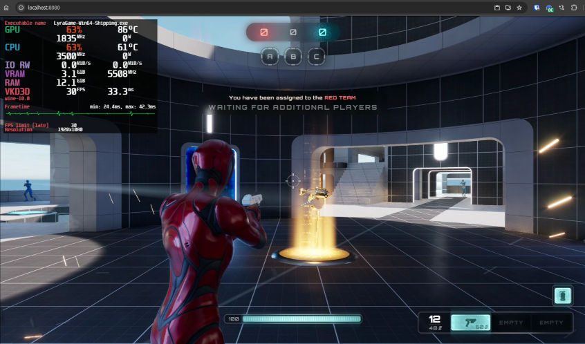

# PS4All — Pixel Streaming for Everyone

Run any application inside a Linux Docker container with full **NVIDIA GPU** acceleration and stream it to your **web browser** through [Selkies](https://github.com/selkies-project/selkies). Use it as the foundation for your own cloud gaming service.

> [!CAUTION]
> **Work in progress.** This is a proof of concept that works on the author's machine with the author's applications. Your mileage may vary. **Use at your own risk.**


*Unreal Engine 5 Lyra running in a browser, streamed from a Docker container.*

## Table of Contents

- [Features](#features)
- [Requirements](#requirements)
- [Installation](#installation)
- [Usage](#usage)
- [Roadmap](#roadmap)
- [License](#license)

## Features

- Built on **Ubuntu 26.04 LTS**.
- Runs Windows applications through a custom **Proton** build (Wine + DXVK + VKD3D).
- Remote access via web browser with **Selkies**, delivering Pixel Streaming-like performance.
- **MangoHud** performance overlay included.

## Requirements

- NVIDIA GPU with driver version **535.xx** or newer
- Linux kernel **5.x** or newer
- Internet connection

## Installation

### 1. Install Docker

Use the official convenience script ([get.docker.com](https://get.docker.com/)):

```bash
curl -fsSL https://get.docker.com -o install-docker.sh
sudo sh install-docker.sh
```

### 2. Install the NVIDIA Container Toolkit

Full instructions are in the [official install guide](https://docs.nvidia.com/datacenter/cloud-native/container-toolkit/latest/install-guide.html). For Debian/Ubuntu:

```bash
# Add the repository
curl -fsSL https://nvidia.github.io/libnvidia-container/gpgkey | sudo gpg --dearmor -o /usr/share/keyrings/nvidia-container-toolkit-keyring.gpg \
  && curl -s -L https://nvidia.github.io/libnvidia-container/stable/deb/nvidia-container-toolkit.list | \
    sed 's#deb https://#deb [signed-by=/usr/share/keyrings/nvidia-container-toolkit-keyring.gpg] https://#g' | \
    sudo tee /etc/apt/sources.list.d/nvidia-container-toolkit.list

# Install the toolkit and configure Docker to use it
sudo apt-get install -y nvidia-container-toolkit
sudo nvidia-ctk runtime configure --runtime=docker
sudo systemctl restart docker
```

### 3. Clone the repository

```bash
git clone https://github.com/Skipperro/ps4all.git
cd ps4all
```

### 4. Build the image

```bash
sudo docker compose build
```

### 5. Add your applications

Copy the applications you want to run into the `app` directory. Archives are not supported — files **must be extracted**.

## Usage

### Start the container

```bash
sudo docker compose up -d
```

### Open the stream

Visit <https://localhost:8080/> in your browser. When connecting from another device, replace `localhost` with the host's IP address.

### Performance overlay

Press **Shift+F12** while streaming to toggle the MangoHud overlay with performance statistics.

## Roadmap

- [ ] Run single applications without a desktop environment
- [ ] Launch a specific application on startup and stop the container when it exits
- [ ] Allow overriding the Selkies UI for custom branding or white-labeling
- [ ] Improve mouse handling for FPS games

## License

See [LICENSE](LICENSE).

